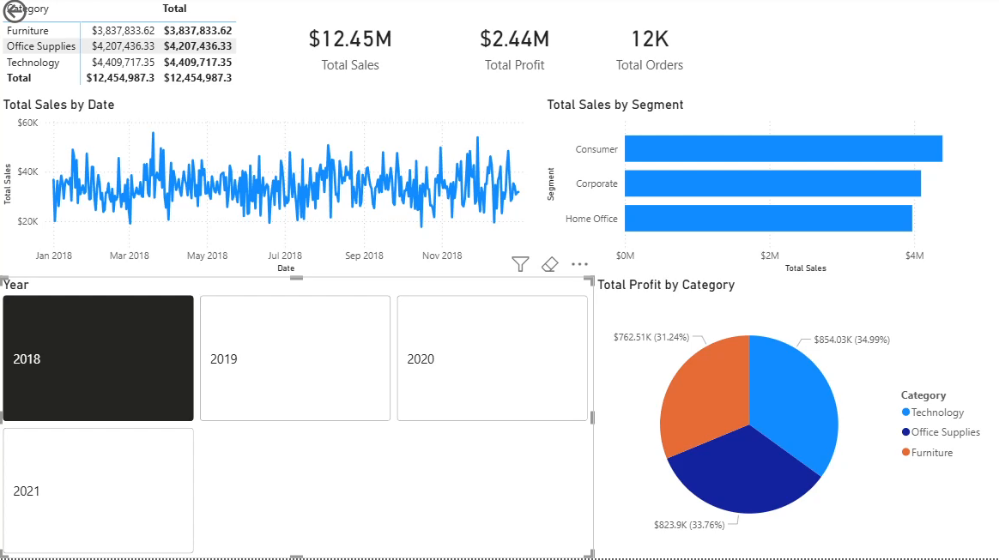
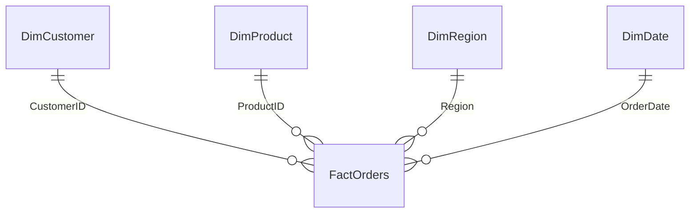

# Retail Sales Performance Dashboard (Power BI)

An end-to-end Power BI report on 50,000 retail orders from 2018 to 2021: data cleaned in Power Query, a star-schema data model, DAX measures, and an interactive dashboard showing sales and profit by category, segment and time.

**Tools:** Power BI Desktop · Power Query (M) · DAX · star-schema data modelling

*Dashboard filtered to 2018 with the year slicer.*

## Business questions

- How much are we selling, and how profitable is it?
- Which product categories and customer segments drive revenue?
- Are there seasonal patterns the business should plan inventory around?

## Data

Five CSV files ([`data/`](data)) with synthetic retail data for a course exercise. There are no real customers.

| Table | Type | Rows | Contents |
|---|---|---|---|
| `FactOrders` | Fact | 50,000 | Order date, ship date, ship mode, sales, quantity, discount, profit |
| `DimCustomer` | Dimension | 1,000 | Customer, segment, city, state, country |
| `DimProduct` | Dimension | 500 | Product, category, sub-category |
| `DimRegion` | Dimension | 4 | East, West, Central, South |
| `DimDate` | Dimension | 1,461 | Continuous calendar, 2018–2021 |

## Data model

A star schema with four one-to-many relationships from the dimension tables to the fact table. `DimDate` is marked as the date table so time-intelligence features work.

## Power Query transformations

1. Renamed source tables to business-friendly names.
2. Profiled every column with Column Quality and Column Distribution. No nulls or errors were found.
3. Promoted headers in the product table so `ProductID` was recognised correctly.
4. Added a numeric quarter column to the date table so quarters sort in the right order.
5. Merged City, Postal Code, State and Country into one `Address` column for customers.

## DAX measures

| Measure | Formula |
|---|---|
| Total Sales | `SUM('Orders Table'[Sales])` |
| Total Profit | `SUM('Orders Table'[Profit])` |
| Total Orders | `DISTINCTCOUNT('Orders Table'[OrderID])` |
| Total Quantity | `SUM('Orders Table'[Quantity])` |
| Profit Margin % | `DIVIDE([Total Profit], [Total Sales], 0)` |
| Avg Sales per Order | `DIVIDE([Total Sales], [Total Orders])` |
| Total Customers | `DISTINCTCOUNT('Customer Table'[CustomerID])` |

`DIVIDE` is used instead of `/` so filtered views with no sales return 0 instead of an error.

## Key findings (2018–2021)

| KPI | Value |
|---|---|
| Total sales | $50.3M |
| Total profit | $9.9M |
| Profit margin | 19.7% |
| Orders | 50,000 (avg. $1,007 per order) |

- **Technology is the top category** at $17.9M in sales, ahead of Office Supplies ($16.9M) and Furniture ($15.6M).
- **Margins are almost identical everywhere.** Every category (19.6–19.9%) and region (19.3–20.1%) is close to the average. Central has the highest margin and East the lowest.
- **Consumer is the largest segment** with 35% of orders, just ahead of Corporate (33%) and Home Office (32%).
- **Q3 is the strongest quarter every year**, so inventory and staffing should be built up before Q3.

## Limitations

- **Synthetic data.** Orders are spread almost evenly across categories, regions and ship modes, so the differences above are small. On real data, the same model and measures would show sharper contrasts.
- **No cost of goods sold.** Profit here is gross profit, not net operating margin.

## How to open

Download `retail_sales_dashboard.pbix` and open it in [Power BI Desktop](https://www.microsoft.com/power-bi/desktop) (free, Windows). If Power BI asks for the data source, point it to the CSV files in `data/`.

## Context

Individual assignment for CPSC-510 Data Warehousing, Master of Data Analytics, University of Niagara Falls Canada (2026).
